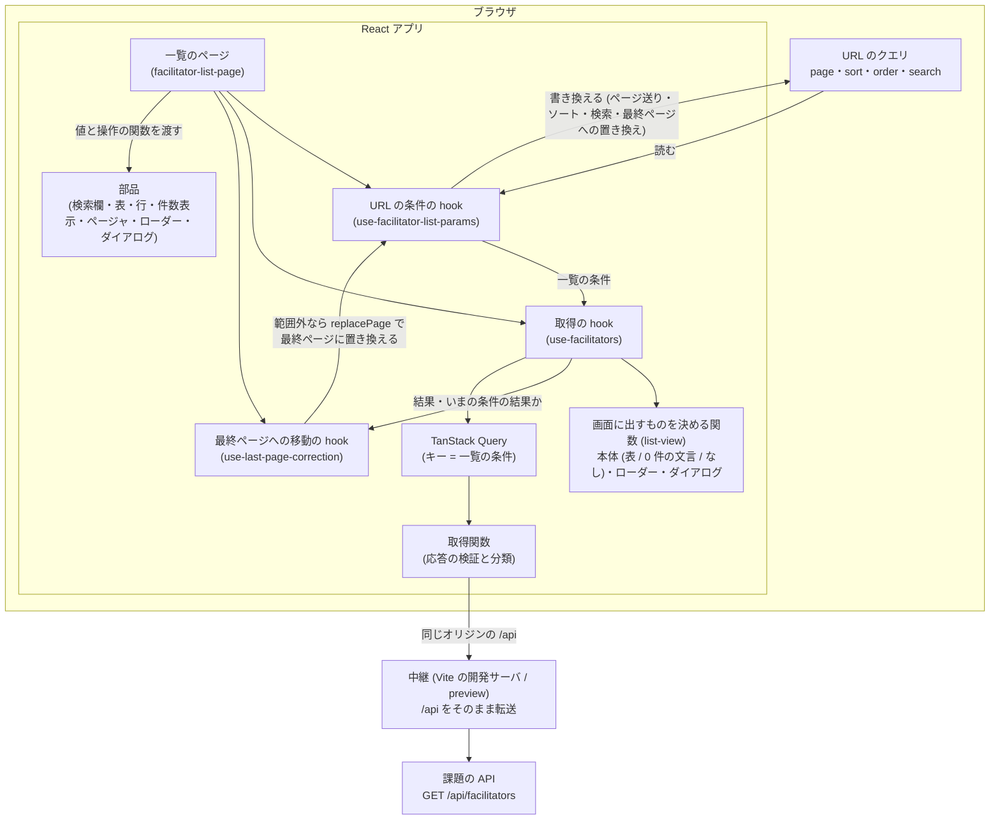
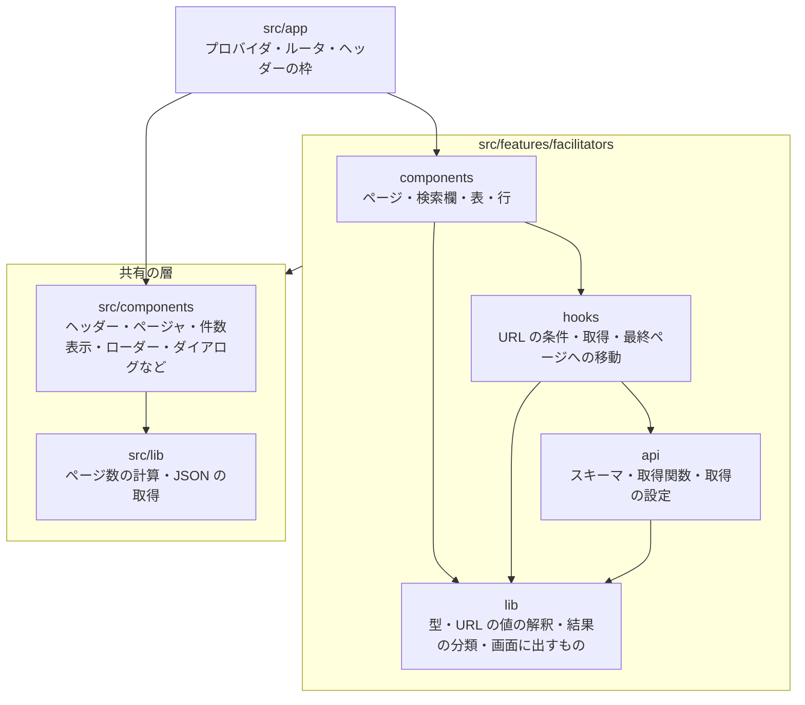

# 先生一覧

API から取得した先生の名前とログインID を、検索・ソート・20 件ごとのページ分割つきで一覧にする画面です。React と TypeScript で作っています。

## 動かす手順

### Node.js と pnpm で動かす

前提:

- Node.js 22.22 以上 (確かめた版は「確かめた環境」)。これより古い Node.js では、`pnpm install` が止まります (pnpm は、プロジェクトの `package.json` の `engines` に合わない Node.js での導入を止めます)。テスト (`pnpm test`) は、jsdom と Vitest が対応する 22.22.2 以上の 22 系、24.15 以上の 24 系、26 以上のどれかで流します。
- 動かす端末から、課題の API へ HTTPS で直接つながること。開発サーバが、端末から API へ通信を中継します ([ADR 0003](docs/adr/0003-cors-proxy.md))。

1. pnpm 10.34.6 を入れます。

   ```sh
   npm install -g pnpm@10.34.6
   ```

2. 依存を入れます。

   ```sh
   pnpm install
   ```

3. 開発サーバを起動し、表示された URL (`http://localhost:5173/`) をブラウザで開きます。

   ```sh
   pnpm dev
   ```

### テストと確認のコマンド

```sh
pnpm test                     # ユニットテスト (Vitest、Testing Library、MSW。API の応答は MSW で差し替える)
pnpm typecheck                # 型検査
pnpm lint                     # oxlint
pnpm exec eslint .            # React Compiler 向けの検査 (eslint-plugin-react-hooks)
pnpm exec prettier --check .  # 整形の確認
pnpm build                    # 本番用のビルド
```

oxlint と ESLint は、別々のコマンドで流します ([ADR 0006](docs/adr/0006-react-compiler.md))。

### ローダーとエラーダイアログの出し方

課題の API は速く、失敗もしないので、ふつうに操作するとローダーもエラーダイアログもほとんど見えません。Chrome の開発者ツールの Network パネルで、回線の状態を変えて確かめます。

- **ローダー**: 回線の速さを遅くして (3G など)、ページ送りやソートを行います。取得中は画面の中央にローダーが出ます。初めて開く条件では前の一覧を出したまま取得し、一度開いた条件 (表示しなくなってから 5 分以内) ではそのときの結果を出したまま取り直します。
- **エラーダイアログ**: `pnpm build` のあとに `pnpm preview` を起動して表示された URL (既定は `http://localhost:4173/`) を開き (下の注意を参照)、回線を Offline にしてから、ページ送りなどを行います。「通信エラーが発生しました。」のダイアログが出ます。回線を戻してから「リトライ」を押すと、取り直してダイアログが閉じます。Esc と外側のクリックでは閉じません。
- 注意: 開発サーバ (`pnpm dev`) の画面は、開発サーバとの接続が切れて再接続すると、ページを読み込み直します。Offline にしたときにこの接続も切れると、「リトライ」を試す前にページが読み込み直されます。`pnpm preview` の画面にはこの仕組みが入らないので、リトライまで確かめられます (中継は `pnpm dev` と同じ設定が効きます。[ADR 0003](docs/adr/0003-cors-proxy.md))。

### 確かめた環境

- macOS 26.5.2 (Apple Silicon)、Node.js 24.21.0、pnpm 10.34.6、Google Chrome 155。Node.js と pnpm は mise で入れたもので、上の手順 1 の `npm install -g` は流していません
- 作業用と別のディレクトリへのまっさらな clone で、上の手順 2・3 と「テストと確認のコマンド」がすべて通ることを確かめました
- 画面は、本物の API を通して確かめました (一覧の表示、検索、ソート、0 件、ページ送り、日本語入力で変換を確定する Enter では検索しないこと)
- ローダーとエラーダイアログは、上の出し方のとおりに出ることを、開発者ツールの回線の設定と同じ仕組み (Chrome DevTools Protocol の回線の模擬) で確かめました
- Windows と Linux では、まだ確かめていません (「やっていないこと」)

## アーキテクチャ

### 構成

一覧の条件は URL に置き、URL が変わると取り直し、取得の状態から画面に出すものを決めて描画します。図の矢印は、呼び出しと、hook のあいだを渡る値を表します (hook のあいだの値は、ページが受け取って渡します)。



いまの条件の結果が範囲外 (存在しないページ) のときは、3 つ目の hook (`use-last-page-correction`) が、ページから受け取った `replacePage` (URL の hook の操作) で、最終ページに置き換えます。

### hook と部品の役割の分担

外の仕組み (URL と取得) は hook が画面の言葉に直し、出し分けの規則は純粋な関数に置き、部品は渡された値を表示します。

| 置き場                        | 受け持つこと                                                                                                                                                                                       |
| ----------------------------- | -------------------------------------------------------------------------------------------------------------------------------------------------------------------------------------------------- |
| `use-facilitator-list-params` | URL のクエリを一覧の条件 (ページ・ソートの列と向き・検索語) に直し、4 つの操作 (ページを変える、ページを置き換える、ソートを切り替える、検索を確定する) を返す。URL を書き換えるのはこの hook だけ |
| `use-facilitators`            | TanStack Query の状態を、手元の結果、それがいまの条件の結果かどうか、画面に出すもの (本体・ローダー・エラーダイアログ)、リトライの関数に直す                                                       |
| `use-last-page-correction`    | いまの条件の結果が範囲外なら、URL の hook の `replacePage` で最終ページに置き換える (履歴は積まない)                                                                                               |
| `facilitator-list-page`       | 3 つの hook を呼び、返った値を部品に渡す。検索の確定で URL が変わらなかったら取り直しの関数を呼ぶ (同じ条件かは URL の hook が判定する)。出し分けの規則と取得の仕組みは持たない                    |
| 共有の部品 (`src/components`) | 渡された値を表示し、操作を関数で知らせる。先生も API も知らない                                                                                                                                    |

### ディレクトリと依存の向き

```text
src/
├── app/                      プロバイダとルータの組み立て
├── features/facilitators/    先生と API の形を知っているもの
│   ├── components/           ページ、検索欄、表、行
│   ├── hooks/                URL の読み書き、取得、最終ページへの移動
│   ├── api/                  応答のスキーマ、取得関数、取得の設定
│   └── lib/                  型、URL の値の解釈、結果の分類、画面に出すものの決定 (純粋な関数)
├── components/               共有の部品 (ヘッダー、ページャ、件数表示、ローダー、ダイアログなど)
├── lib/                      共有の関数 (ページ数の計算、JSON の取得)
└── testing/                  テストの道具
```

import の向きは `app` → `features` → 共有の層 (`src/components`・`src/lib`) の一方向で、`features` の中は `components` → `hooks` → `api` → `lib` の一方向です。この決まりは lint で守らせます ([ADR 0005](docs/adr/0005-feature-directories-and-dependency-rules.md))。

矢印は import の向きです (テストのファイルを除く)。`features` から共有の層への矢印は、`features` の 4 つの置き場からの import をまとめたものです。



## 仕様の解釈

課題の PDF と Zeplin のデザインで決まっていないことや、食い違っていることは、次のように解釈しました。

- **API**: 課題の PDF に載っている API 仕様の画像は古く、現行の API とはパラメータ名 (`page`・`limit`・`sort`・`order`・`search`) と応答の形 (`{ data, totalCount }`) が違います。現行の API に合わせました ([ADR 0007](docs/adr/0007-api-side-query-and-tanstack-query.md))。
- **検索**: PDF の「絞り込み」は、この実装の「検索」に当たります。名前とログインID の部分一致で探します。
- **検索語の整形**: 前後の空白を除きます。空白だけなら検索語なしとして扱います。
- **同じ検索語での確定**: 同じ検索語のまま Enter や検索アイコンで確定しても、取り直します (1 ページ目以外にいるときは、1 ページ目に戻して取得します)。
- **0 件の文言**: Zeplin の「該当するデータはありません」にしました (PDF は「該当するデータがありません。」)。
- **件数表示と 3 列目**: 件数表示「N件中 a〜b件を表示」と、見出しも中身も空の 3 列目は、Zeplin にあり PDF にありません。Zeplin に合わせて作りました。
- **ヘッダー**: 表示だけで、押せる要素はありません。ユーザー名は、デザインの名前を架空の名前「山田花子」に置き換えました (公開する repo に、実在の人かもしれない名前を載せないため)。
- **URL の値**: 存在しないページの URL は、最終ページへ移します (履歴は置き換えます)。解釈できない値は、項目ごとに既定値 (1 ページ目、名前の昇順、検索語なし) にします ([ADR 0008](docs/adr/0008-list-state-in-url.md))。
- **画面の幅**: デザインの基準幅 1024px で作り、それより狭い画面では縮めずに横スクロールにします。

## 再描画の抑制

### 方針

まず状態の置き場所で描画の範囲を狭め、残りを React Compiler に任せます ([ADR 0006](docs/adr/0006-react-compiler.md))。手書きの `memo`・`useCallback`・`useMemo` は書いていません。

状態の置き場所:

- 検索欄の入力中の文字は、検索欄の中の state だけで持ち、確定したときだけ URL に書きます。打つたびに URL や一覧は動きません。
- 一覧の条件の正本は URL です。
- 行の部品 (`FacilitatorRows`) は、行のデータだけを受け取ります。
- 取得中かどうか (`aria-busy`) は、表の外側の要素に付けます。表と行には取得の状態を渡しません。
- 行の要素は取得結果だけから先に作り、表のまとまり (表・行・件数表示・ページャ) を出す条件の外に置きます。条件の中に書くと、React Compiler が表のまとまりを 1 つの単位にまとめて覚え、ページ番号やソートが変わるたびに行の要素も作り直します (`facilitator-list-page.tsx`)。

### 操作ごとに描画される部品

ユニットテストの環境 (jsdom、React Compiler あり) で、部品を `Profiler` で包み、応答を止めて操作の時点と結果が届いたときを分けて測った結果です。

| 操作                                     | 操作の時点で描画される部品                                                            | 結果が届いたとき                 | 行 (`FacilitatorRows`)  |
| ---------------------------------------- | ------------------------------------------------------------------------------------- | -------------------------------- | ----------------------- |
| 検索欄への入力                           | 検索欄だけ                                                                            | (取得しない)                     | 描画されない            |
| ページ送り・ソートの切り替え・検索の確定 | 検索欄、表の枠と列見出し、件数表示、ページャ、ローダー、エラーダイアログ (閉じたまま) | 同じ部品 (ローダーは消える) と行 | 結果が届いたときに 1 回 |
| リトライ (結果のある条件の取り直し)      | 検索欄、ローダー、エラーダイアログ                                                    | 検索欄、エラーダイアログ         | 描画されない            |

検索欄に渡す確定の関数と、エラーダイアログに渡す `onRetry` は、取り直しの関数 (`retry`) を使います。`retry` は取得の状態が変わるたびに作り直されるので、この 2 つの部品はページが描き直されるたびに描画されます (エラーダイアログは閉じたままでも描画されることから分かります)。行は取得結果だけを受け取るので、結果が変わったときだけ描画されます。

### 描画回数のユニットテスト

`src/features/facilitators/components/facilitator-list-page.render-count.test.tsx` が、行の部品の描画回数を数えます。

| 場面                         | 確かめること                                  |
| ---------------------------- | --------------------------------------------- |
| (a) 検索欄に打つ             | 打っているあいだは増えず、取得も始まらない    |
| (b) ページ送り               | 結果が届くまで増えず、届いたときに 1 回増える |
| (c) ソートの切り替え         | 結果が届くまで増えず、届いたときに 1 回増える |
| (d) 結果のある条件の取り直し | リトライの開始では増えない                    |

(b)(c) は、キャッシュに無い条件へ移る場合です。戻る・進むなどでキャッシュのある条件へ移ると、操作の時点でキャッシュの行に切り替わるので、行はその時点で描画されます。

React Compiler を外すと、(b)(c)(d) が落ち、(a) は通ります。(a) は状態の置き場所で抑えているので、コンパイラの有無によりません。外し方は、`vite.config.ts` の `babel({ presets: [reactCompilerPreset()] })` の行を消して、`pnpm exec vitest run src/features/facilitators/components/facilitator-list-page.render-count.test.tsx` を流します。

1 つの画面で、検索欄に打つ → 次のページ → ソートの順に続けて操作して測りました。一覧が初めて出た時点を 1 とした、行の部品の描画回数は次のとおりです。

| 操作                                        | コンパイラあり | コンパイラなし |
| ------------------------------------------- | -------------- | -------------- |
| 検索欄に打つ (打つ前 → 打ったあと)          | 1 → 1          | 1 → 1          |
| 次のページ (操作の前 → 取得中 → 届いたとき) | 1 → 1 → 2      | 1 → 2 → 3      |
| ソート (操作の前 → 取得中 → 届いたとき)     | 2 → 2 → 3      | 3 → 4 → 5      |

### 画面で確かめる手順

`pnpm dev` で開いた画面で、React DevTools を使って確かめられます。

1. Components タブで、React Compiler が変換した部品に印が付いていることを見ます。
2. Profiler で記録しながら、検索欄に打つ、次のページへ送る、を行います。記録の中で、行の部品 (`FacilitatorRows`) がどの操作で描画されたかを見ます。

## 選定理由の要約

詳しい根拠と、採らなかった案は ADR にあります。

| 判断                 | 選んだもの                                                                                                                     | 理由の要点                                                                                                                                                                        | ADR                                                               |
| -------------------- | ------------------------------------------------------------------------------------------------------------------------------ | --------------------------------------------------------------------------------------------------------------------------------------------------------------------------------- | ----------------------------------------------------------------- |
| 構成                 | Vite + React の SPA。URL の条件の読み書きに React Router                                                                       | 要るのは 1 画面のクライアントの UI と、CORS を越える中継だけ。Next.js は、この課題で使わないサーバ側の機能が構成に入るので採らない                                                | [0001](docs/adr/0001-vite-react-spa.md)                           |
| 道具の版             | pnpm 10 系 (10.34.6)、Node.js 22.22 以上                                                                                       | pnpm は宣言していない依存を import できない構造で入れる。Node.js の下限は React Router 8.4 の要求                                                                                 | [0002](docs/adr/0002-pnpm-and-node.md)                            |
| CORS                 | 開発サーバ (と `vite preview`) が `/api` を受けて API へ中継する                                                               | API が CORS を許可しないので、ブラウザからは同じオリジンの `/api` に見せる。アプリは相対パスだけを知る                                                                            | [0003](docs/adr/0003-cors-proxy.md)                               |
| 責務と依存の向き     | 機能に固有のもの (`src/features/facilitators`) と共有のもの (`src/components`・`src/lib`) を分け、依存の向きを lint で守らせる | 共有の部品が先生の事情を知らずに動く。決まりをレビューに頼らず機械で守る                                                                                                          | [0005](docs/adr/0005-feature-directories-and-dependency-rules.md) |
| 再描画の抑制         | 状態の置き場所で範囲を狭め、残りを React Compiler に任せる                                                                     | 手書きのメモ化は、依存の書き漏れで気づかないまま効かなくなる。コンパイラが最適化できない書き方は lint (ESLint の react-hooks と oxlint) で見つける                                | [0006](docs/adr/0006-react-compiler.md)                           |
| 取得                 | ソート・検索・ページ分割は API に任せ、取得は TanStack Query。応答は zod で検証する                                            | API が条件に合う 1 ページ分と総件数を返すので、画面が受け取るのは最大 20 件。条件をキーにした取得、切り替えのときの中断、前の結果の引き継ぎ、キャッシュを TanStack Query に任せる | [0007](docs/adr/0007-api-side-query-and-tanstack-query.md)        |
| 一覧の条件           | URL のクエリ (`page`・`sort`・`order`・`search`) を正本にし、React の state に写さない                                         | リロード、戻る・進む、URL の共有で同じ一覧を出せる。状態を 2 か所に持たないので、そろえる処理が要らない                                                                           | [0008](docs/adr/0008-list-state-in-url.md)                        |
| 取得の失敗           | 通信の失敗と使えない応答を、同じダイアログで知らせ、「リトライ」で取り直す。自動の再試行はしない                               | どの失敗でも、利用者が取れる手は「リトライ」で同じ。失敗はすぐ知らせ、やり直すかは利用者が決める。オフラインでも取得し、失敗としてダイアログを出す                                | [0009](docs/adr/0009-fetch-failure-handling.md)                   |
| スタイルとダイアログ | Tailwind CSS v4 (`@theme` にデザインの色とフォント)。エラーダイアログは Base UI の AlertDialog                                 | デザインの色を同じ名前のクラスで使える。ダイアログのフォーカスの移動や背後の扱いを自前で書かずに済み、見た目は持たないのでデザインに合わせられる                                  | [0010](docs/adr/0010-tailwind-and-base-ui.md)                     |

## やっていないこと

計画していたが、期限までに入れていないもの:

- E2E テスト (Playwright。axe による自動検査、キーボードだけの操作、寸法の確認、本物の API を通す 1 本を含む)
- Docker での起動の手順 (起動用と開発用のコンテナ)
- CI (GitHub Actions。Windows と macOS のジョブを含む)
- Windows と Linux の実機での確認 (CI で確かめる予定でした)
- oxlint と ESLint を 1 つのコマンド (`pnpm lint`) で両方流す形
- README に載せるローダーとエラーダイアログの画像
- ADR 0004 (動かす手順を Docker 第一にする) と 0011 (テストの層) は、コンテナと E2E の変更と一緒に書く予定で、番号を空けています

範囲の外にしたもの:

- 1024px より狭い画面向けのレイアウト (横スクロールにする)
- 一覧以外の機能 (先生の追加・編集・削除、詳細画面、ログイン)。ヘッダーは表示だけ
- 入力のたびの検索、複数語での検索、全角英数の正規化、読みがなでの検索
- 五十音順のソート (API の並びは文字コード順)
- ダークモード、多言語対応
